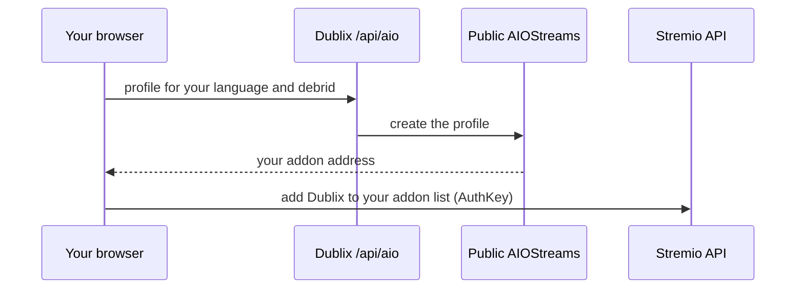
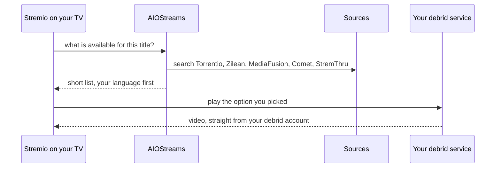

<div align="center">

# Dublix

**Your language first. Streams for Stremio.**

A one-page setup that builds a tuned [AIOStreams](https://github.com/Viren070/AIOStreams) profile for your debrid account or P2P torrents, puts releases in your language (dubbed or dual-audio) first in every quality, and installs it into your Stremio account without touching your other addons.

[](LICENSE)


### [Open the setup site → dublix.stremio.ncls.cc](https://dublix.stremio.ncls.cc)

</div>

---

## Why

Stremio with a debrid service shows dozens of near-identical results, and finding the dubbed version in your language means scrolling and guessing. Dublix keeps a short list per quality: your language first, then one original-audio option, cached results first, best quality first. It started as a Brazilian Portuguese setup for one household and grew into a public, language-aware tool.

## Features

- **Short, ordered list.** For each quality (4K, 1080p, 720p): up to 2 options in your language and 1 original-audio option, all configurable, with clear labels such as `Dual áudio`, `PT-BR`, `Latino` or `Original`.
- **Any language.** Curated profiles for Portuguese (Brazil), English, Spanish (Latin America and Spain), French, Italian and German, plus basic support for every other language AIOStreams knows. An "only my language" switch hides original audio. See [docs/languages.md](docs/languages.md).
- **Smart subtitles (optional).** No subtitles on files in your language; subtitles in your language on any other audio, from OpenSubtitles v3.
- **No server needed.** The profile runs on a public AIOStreams instance; video goes straight from your debrid service to your device.
- **Self-host kit** with fixes for Brazilian season-pack names, a private instance and your own subtitles server. See [kit/README.md](kit/README.md).
- **Safe install.** Only Dublix's own addons are added or replaced. A backup of your addon list downloads first, and the page can restore it. You paste a Stremio AuthKey; the page never asks for your Stremio password.
- **Debrid services:** TorBox, Real-Debrid, AllDebrid, Premiumize, Debrid-Link, Offcloud and Easynews.
- **Debrid is optional.** Remove the last service with × and accept the warning to use P2P torrents from Torrentio. Seeds determine availability and speed; playback may buffer or fail. A Stremio player with P2P support is required, and your IP is visible to peers. Within each language and quality, torrents with more seeds come first. Other sources and the cloud library are disabled in this mode because their public endpoints may require debrid or reject P2P configurations.

## How it works

**Setup, once.** Your browser does the work; the profile passes through `/api/aio` a single time.



**Every time you watch.** Dublix is out of the way; video never passes through it.



The setup page is static. Its only server-side parts are two small Cloudflare Pages Functions: `/api/aio`, which passes the profile to an allow-listed public instance once (those instances send no CORS headers), and `/subs/*`, the stateless subtitles addon. Nothing is logged or stored.

## Getting started

1. Open **[dublix.stremio.ncls.cc](https://dublix.stremio.ncls.cc)**.
2. Paste your Stremio AuthKey (the page shows how to copy it from web.stremio.com).
3. Add your debrid key, or remove the service with × to use P2P. Add a free [TMDB](https://www.themoviedb.org/settings/api) key if you can: it keeps franchise entries apart.
4. Pick your language, the qualities and how many options you want, then **Review** and **Install**.

To run your own instance instead of a public one, follow [kit/README.md](kit/README.md) and choose **My own server** on the page.

## Measured results

Portuguese (Brazil) was measured on 102 titles (films, series, anime, Brazilian packs, franchises):

- A public instance returns about 95% of the same options as the self-hosted version.
- Without the kit's patches, 3 of 102 titles showed the wrong episode first (Brazilian season packs).
- Without a TMDB key, title and year checks are off and franchise entries get mixed up (Part 2 shown for Part 1).

The other languages passed a real-stream check on 9–15 titles each (no errors, no wrong title at the top), with known labelling issues listed in [docs/languages.md](docs/languages.md#real-stream-check-2026-11-08). Labels come from file names and AIOStreams tags; audio tracks are not inspected.

## Project structure

| Path | What it is |
| --- | --- |
| [AGENTS.md](./AGENTS.md) | Project checks and invariants for agents; [CLAUDE.md](./CLAUDE.md) includes it. |
| `packages/policy` | List policy, language profiles, the public base profile and the profile builder. Pure ES modules for Node and the browser. |
| `packages/stremio` | Non-destructive merge of the Dublix addons into a Stremio addon collection. |
| `packages/proxy` | The `/api/aio` bridge to allow-listed public instances. |
| `packages/subs` | Dublix Subs, one subtitles addon per language. |
| `site/`, `functions/` | Setup site and its Cloudflare Pages Functions. |
| `kit/` | Self-host kit: patched AIOStreams, subtitles and gateway. |
| `tools/` | Checks for your own instance: gateway exposure, stream smoke test and benchmark. See [tools/README.md](tools/README.md). |
| `scripts/`, `tests/e2e/` | Build, local preview, base profile export and browser tests. |

## Development

Node.js 20 or later, no npm dependencies.

```sh
npm test       # unit tests (packages, kit and tools)
npm run dev    # build and serve the site with its functions on http://127.0.0.1:8788
```

Browser tests, deployment and updating the base profile are described in [CONTRIBUTING.md](CONTRIBUTING.md). Security notes and how to report a problem are in [SECURITY.md](SECURITY.md).

## Acknowledgements

Dublix is a thin layer over the work of many people. Thank you to:

- **[AIOStreams](https://github.com/Viren070/AIOStreams)** by [Viren070](https://github.com/Viren070), the engine that aggregates, filters, sorts and formats every result. Dublix's kit patches it (`kit/compat`) under its AGPL-3.0 license.
- **[Tamtaro's SEL filtering and sorting templates](https://github.com/Tam-Taro/SEL-Filtering-and-Sorting)** by [Tam-Taro](https://github.com/Tam-Taro): the base profile's filters, ranking expressions and result formatter come from the Tamtaro template.
- **[Releases-Regex](https://github.com/Vidhin05/Releases-Regex)** by [Vidhin05](https://github.com/Vidhin05): release-group regexes and ranked expressions synced into the profile.
- **[Torrentio](https://github.com/TheBeastLT/torrentio-scraper)** by [TheBeastLT](https://github.com/TheBeastLT), including its language-specific providers.
- **[Zilean](https://github.com/iPromKnight/zilean)** by [iPromKnight](https://github.com/iPromKnight), **[MediaFusion](https://github.com/mhdzumair/MediaFusion)** by [mhdzumair](https://github.com/mhdzumair), **[Comet](https://github.com/g0ldyy/comet)** by [g0ldyy](https://github.com/g0ldyy) and **[StremThru](https://github.com/MunifTanjim/stremthru)** by [MunifTanjim](https://github.com/MunifTanjim), the other stream sources.
- **[Stremio](https://www.stremio.com)**, its addon SDK and API, Cinemeta, and the **OpenSubtitles v3** addon used by Dublix Subs, with subtitles from **[OpenSubtitles](https://www.opensubtitles.org)**.
- The operators of the public AIOStreams instances the site offers (**Midnight's For the Weebs** and **For The Weak**) and **[ibbylabs](https://uptime.ibbylabs.dev)** for the health checks the profile uses.
- **[Stremio Account Bootstrapper](https://github.com/DryKillLogic/stremio-account-bootstrapper)** by [DryKillLogic](https://github.com/DryKillLogic), building on pancake3000's original work and the redd-ravenn fork, which inspired the setup flow. No code was copied.
- **[Inter](https://github.com/rsms/inter)** by Rasmus Andersson, the site's typeface (SIL Open Font License, see `site/fonts/OFL.txt`).
- **[TMDB](https://www.themoviedb.org)** for metadata. This product uses the TMDB API but is not endorsed or certified by TMDB.

## Author

Created and maintained by **Nicolas Elias** ([@nicolaseliasx](https://github.com/nicolaseliasx)).

## License

[AGPL-3.0](LICENSE). The kit's patches modify AIOStreams, which is also AGPL-3.0; if you run a modified version as a public service, publish your changes.

Dublix is not affiliated with Stremio, AIOStreams, TMDB, OpenSubtitles or any debrid service. It does not host, index or distribute any content; it configures software that you run against services you subscribe to.
